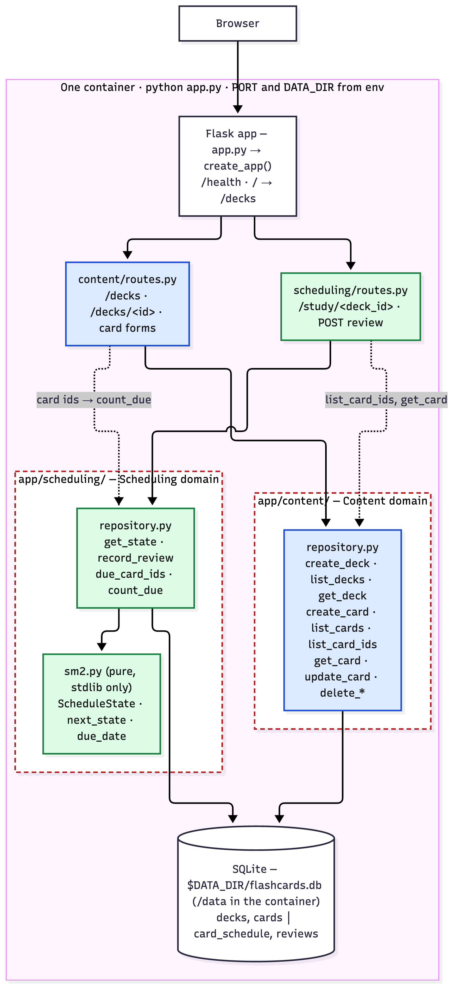

# sdd-flashcards

Spaced-repetition flashcards, Anki-style. You create decks of front/back cards, study the cards that are due today, grade each answer from 0 to 5, and the app decides when to show each card again using the SM-2 algorithm. One Flask process, one SQLite file, no JavaScript.

Two backend feature domains:

- **Content** (`app/content/`): decks and cards — create, list, view, delete. Owns the `decks` and `cards` tables.
- **Scheduling** (`app/scheduling/`): when each card is next due, computed from review grades with SM-2. Owns the `card_schedule` and `reviews` tables.

## Requirements

- Python 3.11 or newer (developed on 3.12)
- or Docker, to run it in a container (see below)

## Setup & run

```bash
python -m venv .venv && source .venv/bin/activate
pip install -r requirements.txt
python app.py            # http://localhost:8000
```

The first start creates `./data/flashcards.db` and applies the schema. No `.env` file, no setup wizard, no migration step.

## Run in Docker

The `Dockerfile` is the course-provided template with its four `TODO` lines filled in (base image, dependency install, source copy, start command); nothing else in it was changed.

```bash
docker build -t sdd-flashcards .
docker run -p 8000:8000 -v sdd-flashcards-data:/data sdd-flashcards          # http://localhost:8000
docker run -e PORT=9000 -p 9000:9000 -v sdd-flashcards-data:/data sdd-flashcards
```

Inside the container `DATA_DIR=/data`, so the database is `/data/flashcards.db` on the named volume and survives the container being removed and recreated. The schema is created with `CREATE TABLE IF NOT EXISTS` on every start; there is no seed data and nothing is dropped, so a restart never changes the data.

### Contract check

Output of the course's `container/run.sh` on 2026-10-09 (run on `PORT=8100` because 8000 was in use by another container on the host; the second start on port 9123 is the checker's own `PORT` override test):

```
=== SDD Assignment 1 contract check ===
Repository: /Users/dominicpotec/Desktop/year3/devops/assignemt1/sdd-flashcards

==> Repository shape
  PASS  one Dockerfile, one manifest (requirements.txt)

==> Build from a clean context, no build args
  PASS  image built
  PASS  image size 53 MB

==> Start on PORT=8100 and reach it from the host
  PASS  HTTP 302 from http://localhost:8100/

==> SQLite file under DATA_DIR
  PASS  found in /data: flashcards.db 

==> Data persists, and a second boot does not re-seed
  PASS  volume at /data persists
  PASS  row counts unchanged across restart: card_schedule=0 cards=0 decks=0 reviews=0 

==> PORT override is honoured (not hardcoded)
  PASS  HTTP 302 from http://localhost:9123/

=== ALL CHECKS PASSED ===
Paste this output into your README as the §7 evidence.
```

## Configuration

Everything is read from environment variables in `app/config.py`, each with a default, so the app runs with no configuration at all.

| Variable | Default | Meaning |
|---|---|---|
| `PORT` | `8000` | Port the server listens on. It always binds `0.0.0.0`. |
| `DATA_DIR` | `./data` (relative to the working directory; `/data` in the container) | Directory for the SQLite file. Created if missing. |
| `DB_PATH` | `$DATA_DIR/flashcards.db` | Full path of the SQLite database. |
| `SECRET_KEY` | `dev-only-change-me` | Flask session key, used only for flash messages. Set a real value outside development. |

Example: `PORT=9000 DATA_DIR=/tmp/fc python app.py` listens on 9000 and writes `/tmp/fc/flashcards.db`.

## Testing

```bash
pytest --cov=app --cov-report=term-missing
```

Output on 2026-10-09:

```
Name                           Stmts   Miss Branch BrPart  Cover   Missing
--------------------------------------------------------------------------
app/__init__.py                   25      0      4      1    97%   13->16
app/config.py                      5      0      0      0   100%
app/content/__init__.py            0      0      0      0   100%
app/content/repository.py         45      0      8      0   100%
app/content/routes.py             50     21      6      0    55%   33-34, 40-44, 49-55, 60-61, 66-70
app/db.py                         13      0      0      0   100%
app/scheduling/__init__.py         0      0      0      0   100%
app/scheduling/repository.py      27      0      4      0   100%
app/scheduling/routes.py          35     14      8      2    58%   34, 39-41, 48-57
app/scheduling/sm2.py             24      0      8      0   100%
--------------------------------------------------------------------------
TOTAL                            224     35     38      3    83%
============================== 39 passed in 0.19s ==============================
```

Coverage is measured on all of `app/` with branch coverage on (see `.coveragerc`; pytest options are in `pytest.ini`). The scheduler (`sm2.py`) and both repositories are at 100%; the uncovered lines are route handlers, which are covered only by the four smoke tests in `tests/test_app_smoke.py` (see ADR-4).

## Project layout

```
app.py                      entrypoint: create_app(), binds 0.0.0.0 on PORT
requirements.txt            the one dependency manifest (flask, pytest, pytest-cov, pinned)
Dockerfile                  course template with its four TODOs filled
pytest.ini, .coveragerc     test and coverage configuration
ADR.md, AI_USAGE.md         process logs (see Process below)
app/
  __init__.py               create_app factory: config, init_db, blueprints, /health, / redirect
  config.py                 PORT, DATA_DIR, DB_PATH, SECRET_KEY from the environment
  db.py                     get_conn() with foreign keys on; init_db() applies schema.sql
  schema.sql                the four tables and two indexes
  content/                  Content domain: repository.py (deck/card SQL), routes.py (/decks pages)
  scheduling/               Scheduling domain: sm2.py (pure SM-2), repository.py (schedule + reviews SQL), routes.py (/study pages)
  templates/                base, decks, deck, study (Jinja)
  static/style.css
tests/                      conftest fixtures, SM-2 unit tests, both repository test files, app smoke tests
docs/                       architecture and schema diagrams (PNG + Mermaid source)
```

## Architecture



The browser talks to one Flask process. The two domains are sibling packages that never import each other's internals: `content/repository.py` and `scheduling/repository.py` + `sm2.py` each know only their own tables. The only code that calls both is the two `routes.py` modules, and the only thing that crosses the seam is **card ids**: the study route asks Content for a deck's card ids, asks Scheduling which of those are due, then asks Content for the text of the first one. Scheduling never sees card text; Content never sees ease factors or due dates. See ADR-2.

## Database


Four tables in one SQLite file. `decks` and `cards` belong to Content; `card_schedule` (one current-state row per card, created on its first review) and `reviews` (append-only log of every grade) belong to Scheduling. The only link between the domains is the foreign key from the two scheduling tables to `cards.id`, with `ON DELETE CASCADE` so deleting a card or deck removes its schedule and history. See ADR-3.

## Migrations

Each service has numbered SQL files in its `migrations/` folder. At startup `app/migrate.py` applies, in order, the ones not yet listed in the service's `schema_migrations` table, each in one transaction. An applied file is never edited; a change is a new file.

`services/scheduling/migrations/002_add_lapses.sql` changed a table that already held data on Azure: it adds `lapses` to `card_schedule` and fills it from the existing `reviews`. The evidence is in [`docs/evidence/migration.md`](docs/evidence/migration.md): the deployment run, the startup log line `applied migration 002_add_lapses`, and the live data before and after, with all five rows kept and the two cards that had been answered wrong showing `lapses` 1.

## Partial failure

The two services fail separately. Scheduling calls content in one place only, to get a deck's cards for the study page and the due count, with a 2 second timeout.

| Down | Still works | What the user gets |
|---|---|---|
| content | saving a review (`POST /reviews`), reading a card's schedule, scheduling's `/health` | `GET /study/{deck_id}/next` and `/due-count` answer `503 {"error":"content service unavailable"}` within the timeout. The Study page says "Study is unavailable right now (content service unavailable)." Decks cannot be listed, because that is content's own job. |
| scheduling | listing, creating and deleting decks and cards | The Decks page lists the decks with "—" in the due column and says "Scheduling is unavailable: due counts cannot be shown right now." The Study page says "Study is unavailable right now". |

Neither `/health` calls the other service. The recorded responses, with timings, are in [`docs/evidence/partial-failure.md`](docs/evidence/partial-failure.md).

## Pipeline

One GitHub Actions workflow, [`.github/workflows/pipeline.yml`](.github/workflows/pipeline.yml), runs on every push to any branch and on every pull request to `main`. A job that fails makes the run red, and a red pull request is not merged.

| Job | Runs | Fails when |
|---|---|---|
| `test` | once per service, against a throwaway SQL Server container | flake8 reports a problem, a test fails, or coverage of `app/` is below 70% |
| `validate-docs` | once | an `openapi.yaml` is not valid OpenAPI, or `system.yaml` does not match `system.schema.json` or names a path that does not exist |
| `images` | once per service | the Dockerfile does not build; on `main` it also pushes the image to GHCR tagged with the commit SHA |
| `integration` | once | the compose stack does not become healthy, or a test in `tests/integration` fails, including the one that stops the content service |

CI never touches Azure SQL: the `test` job and the compose stack each use their own local SQL Server. Evidence of a failed run that was fixed is in [`docs/evidence/pipeline.md`](docs/evidence/pipeline.md).

## Azure initial setup

Live system: <https://dpotecieu2024ui.z1.web.core.windows.net>. The first request after a quiet period is slow, because the containers and the databases start again.

The system runs in my own Azure for Students subscription and follows the course's A2 deployment guide. Everything is created once by [`infra/azure-setup.sh`](infra/azure-setup.sh), run by hand from the repo root. Every `az` and `gh` command of the setup is in that script. After it, the pipeline does every deployment and nothing is created or changed in the portal.

What it creates, all in the resource group `rg-dpotec-ieu2024`:

| Resource | Name | Settings |
|---|---|---|
| Storage account | `dpotecieu2024ui` | StorageV2, Standard_LRS, static website with `index.html`: the UI |
| SQL logical server | `dpotec-ieu2024-sql` | firewall rule "allow Azure services" only |
| SQL database, content | `dpotec-ieu2024-content-db` | serverless, General Purpose Gen5, 0.5 to 1 vCore, local backups, free offer (pauses after 60 idle minutes) |
| SQL database, scheduling | `dpotec-ieu2024-scheduling-db` | same |
| Container Apps environment | `dpotec-ieu2024-env` | Consumption; Azure creates its Log Analytics workspace with it |
| Container App, content | `dpotec-ieu2024-content` | 0 to 1 replicas, public HTTPS ingress on port 8000 |
| Container App, scheduling | `dpotec-ieu2024-scheduling` | same |
| Managed identity | `dpotec-ieu2024-github` | Contributor on this resource group only; the pipeline signs in as it |

Steps:

1. `az login` with the IE account and `az account set --subscription <the Azure for Students id>`. Have `gh` signed in as the repository owner and Docker running (the script uses the SQL Server image to run `sqlcmd`).
2. Run `./infra/azure-setup.sh`. It shows the subscription, region and repository and asks before creating anything. In order, it:
   - registers the resource providers and creates the resource group;
   - creates the storage account and turns on its static website. The web endpoint becomes `UI_ORIGIN`, the only origin CORS allows; CORS is done by the services themselves, and the Container Apps ingress CORS setting stays off;
   - creates the SQL server and the two serverless databases on the free offer;
   - opens the SQL firewall for this machine's IP, runs [`infra/azure-user.sql`](infra/azure-user.sql) on each database (a contained user that exists in that database only, with the roles needed to run migrations and read and write data), then removes the firewall rule;
   - creates the Container Apps environment and both apps on a placeholder image, with the database URL stored as a Container App secret and `CONTENT_URL` on scheduling pointing at the content app;
   - creates the managed identity, makes it Contributor on the resource group, and adds two federated credentials for the `main` branch of this repository (GitHub can name the repository by name or by numeric id);
   - stores what the pipeline needs in GitHub (table below);
   - gives the two professors the Reader role on the resource group.

| GitHub Actions | Name | Value |
|---|---|---|
| secret | `AZURE_CLIENT_ID`, `AZURE_TENANT_ID`, `AZURE_SUBSCRIPTION_ID` | which identity, directory and subscription the pipeline signs in to. There is no stored Azure password: Azure trusts the token GitHub issues for `main` (OIDC) |
| secret | `CONTENT_DB_PASSWORD`, `SCHEDULING_DB_PASSWORD` | the password of each service's database user; the deploy job builds each `DATABASE_URL` from it |
| secret | `CI_SA_PASSWORD` | any strong password; used only by the throwaway SQL Server in CI. Set by hand, not by the script |
| variable | `PREFIX`, `RESOURCE_GROUP`, `UI_STORAGE` | `dpotec-ieu2024`, `rg-dpotec-ieu2024`, `dpotecieu2024ui` |

The script keeps resources that already exist, so it can be run again after a failure. The three passwords (SQL administrator and the two database users) are generated inside the script, sent to Azure and to GitHub secrets, and never typed, printed or written to a file. Running the script again sets new ones everywhere.

On every push to `main`, after all CI jobs pass, the `deploy` job points each Container App at the image of that commit, writes the services' addresses into `ui/config.js`, uploads `ui/` to the storage account's `$web` container, and fails unless `/health` of both services reports that commit within five minutes.

## Process

- [`ADR.md`](ADR.md): the five architecture decision records (framework, domain split, schema, testing, what was left out).
- [`AI_USAGE.md`](AI_USAGE.md): one row per AI interaction, with what was accepted, modified or rejected, and how the resulting code works.
